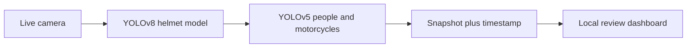
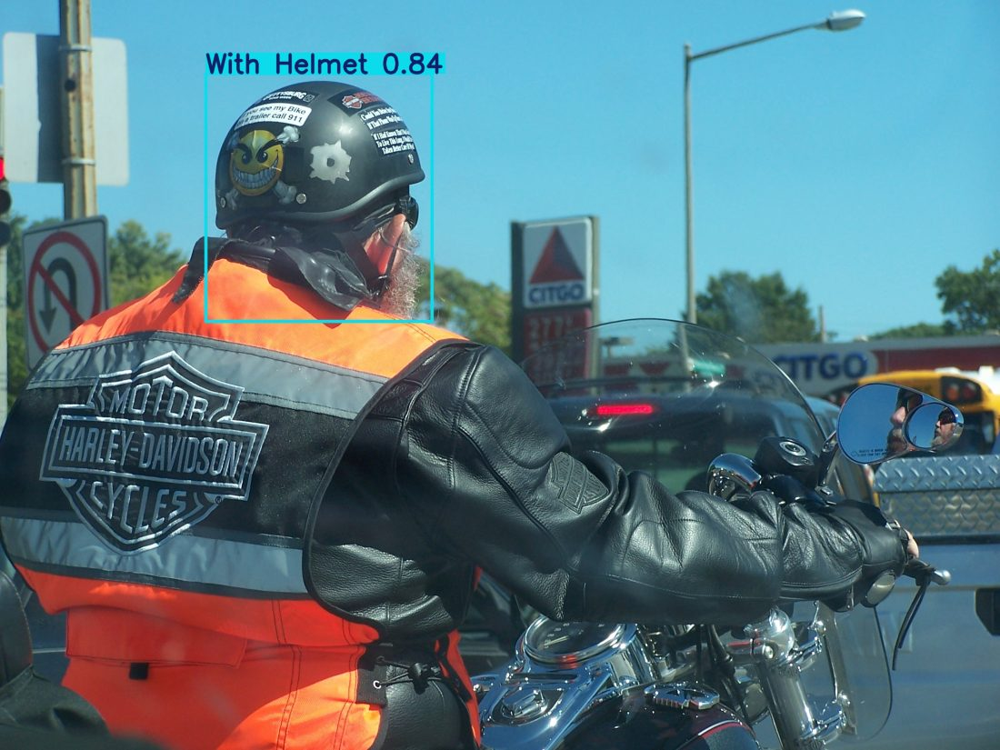
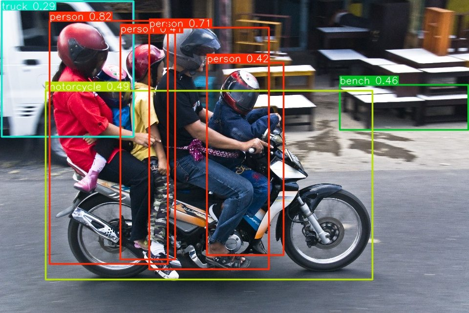
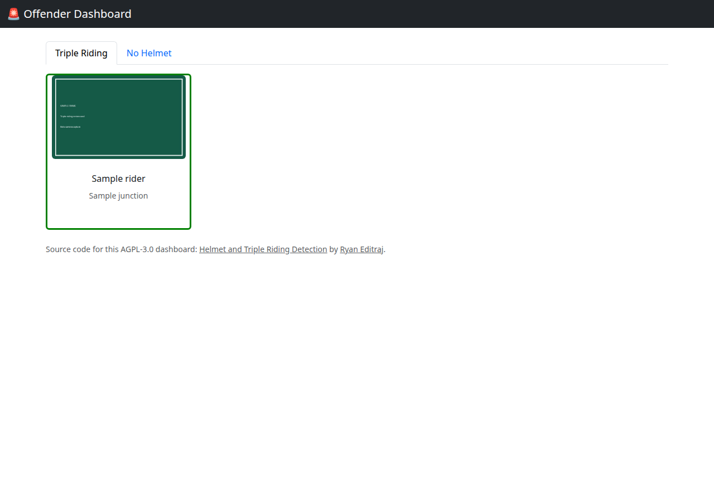
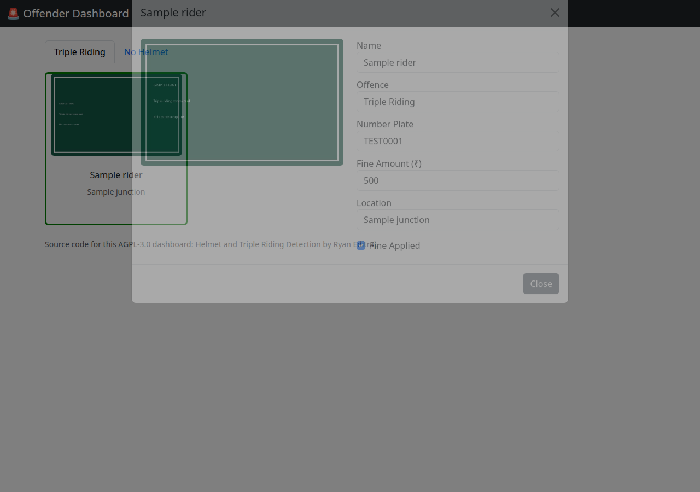
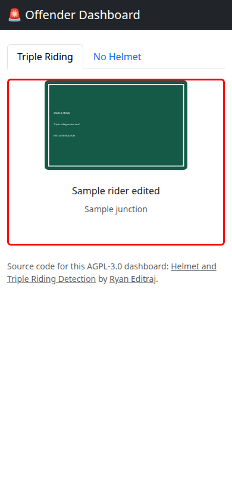

# Helmet and triple-riding detection

**Spot riders without helmets and three people on one motorcycle, then review every capture on a local dashboard.**

[](LICENSE)
[](https://www.python.org/)
[](https://docs.ultralytics.com/)
[](https://github.com/ultralytics/yolov5)
[](https://github.com/ryaneditraj/Helmet-and-Triples-Detection-using-Yolov5-and-Yolov8/actions/workflows/ci.yml)

This is a computer-vision project for two common motorcycle offences. A custom **YOLOv8** checkpoint (`best.pt`) tells "With Helmet" from "Without Helmet". **YOLOv5s** finds people and motorcycles, and the script treats three nearby people plus a nearby motorcycle as triple riding. Each hit is saved as a timestamped snapshot. A small **Flask** dashboard is where you add a name, a number plate, a fine in rupees, and whether that fine was applied.

It is a local experiment for road-safety and traffic-violation review. It is not an official enforcement product, and it does not read plates on its own.



## Demo

The camera scripts open an OpenCV window. This environment has no webcam, so the frames below are real headless runs of the same weights and the same drawing code. The dashboard screenshots are from `python offender.py`.

### No-helmet model

`best.pt` on a Creative Commons photo. The only detection was **With Helmet** at 0.84.



Photo: [Half helmet Harley-Davidson rider](https://commons.wikimedia.org/wiki/File:Half_helmet_Harley-Davidson_rider.jpg) by diluvi.com Anna i Adria, [CC BY 2.0](https://creativecommons.org/licenses/by/2.0), via Wikimedia Commons. The picture was scaled to 1100 pixels wide after inference.

### Triple riding

`yolov5s.pt` on a photo of several people sharing a motorcycle. The detector returned four people and one motorcycle, and the project's 20-pixel grouping rule matched.



Photo: [5 on a motorcycle](https://commons.wikimedia.org/wiki/File:5_on_a_motorcycle_(2889845973).jpg) by Guillaume, [CC BY 2.0](https://creativecommons.org/licenses/by/2.0), via Wikimedia Commons. Inference used a 960×640 copy of that photo.

### Review dashboard

Sample cards, not real cases. The original capture photos were never committed, so these frames are labeled samples.







## Features

- Live no-helmet detection with the included YOLOv8 weights.
- Triple-riding detection from person and motorcycle boxes, not a second custom classifier.
- A new session folder on the first hit, then a snapshot every 250 ms for helmets, for 10 seconds.
- Raw frames saved beside the annotated preview, so the file is the camera image rather than the drawn boxes.
- Dashboard tabs for **No Helmet** and **Triple Riding**, with a green or red border for whether the fine was applied.
- Edits saved to `offenders_data.json` when a field changes.
- AGPL source link in the dashboard footer, so people using the web UI can find the code.

## Tech stack

| Piece | Role |
| --- | --- |
| Python 3.12 | Language used in CI |
| Ultralytics YOLOv8 | Helmet model loader and annotated preview |
| YOLOv5s via `torch.hub` | Person and motorcycle boxes |
| OpenCV | Camera, snapshots, and the preview window |
| Flask | Local review dashboard |
| Bootstrap 5.3 | Dashboard layout, served from this repo |

Checkpoints in the repo:

| File | Used by |
| --- | --- |
| `best.pt` | `helmets.py`. Classes: `With Helmet`, `Without Helmet` |
| `yolov5s.pt` | `triples.py` and `test.py` |
| `yolov8n.pt` | Not loaded. Stock YOLOv8 nano weights kept next to the custom helmet model |

## Quick start

```bash
python -m venv .venv
source .venv/bin/activate  # Windows: .venv\Scripts\activate
pip install -r requirements.txt
cp .env.example .env
python offender.py
```

Open http://127.0.0.1:5000 . An empty category is normal until a camera script has written a session folder.

CPU-only PyTorch, if you want the smaller wheel instead of the default build:

```bash
pip install torch==2.14.1 torchvision==0.29.1 --index-url https://download.pytorch.org/whl/cpu
pip install -r requirements.txt
```

A GPU wheel from [pytorch.org](https://pytorch.org) is fine too, as long as it is PyTorch 2.6 or newer. `requirements.txt` pins 2.14.1, which is past the CVE-2025-32434 fix in 2.6.0.

## Usage

### Dashboard

```bash
python offender.py
```

The page reads folders under `static/no_helmet/` and `static/triples/`. Change a field and it is written to `offenders_data.json`. The offence label is fixed for each tab. There is no login, so keep the server on localhost.

### No-helmet camera

```bash
python helmets.py
```

When prompted, enter a camera index (`0` or `1` are the usual webcam and OBS virtual camera). Press `q` to quit. A "Without Helmet" detection starts `static/no_helmet/NO_HELMET_session_YYYYMMDD_HHMMSS/` and saves a frame every quarter second for ten seconds.

Set `CAMERA_SOURCE` in `.env` to skip the prompt.

### Triple riding

```bash
python triples.py
```

The first run clones `ultralytics/yolov5` through `torch.hub` and needs a network. After that, the hub cache is enough. A capture is saved only when all of these are true:

- at least three `person` boxes
- every pair in that trio is within 20 pixels
- at least one `motorcycle` box
- that motorcycle is within 20 pixels of a person

Folders are named `static/triples/THRIPLES_session_*`. The prefix is spelled **THRIPLES** in code so older sessions still line up. Do not rename it unless you also migrate old directories.

`test.py` is the same loop with the camera defaulting to device `1`, and it writes `session_*` in the current directory instead of `static/triples/`. Use `triples.py` for the dashboard.

## Configuration

| Variable | Default | Purpose |
| --- | --- | --- |
| `SECRET_KEY` | random each launch | Signs the dashboard CSRF cookie |
| `FLASK_HOST` | `127.0.0.1` | Bind address. Debugger is refused off loopback |
| `FLASK_PORT` | `5000` | Dashboard port |
| `FLASK_DEBUG` | `0` | Set to `1` only on localhost |
| `SESSION_COOKIE_SECURE` | `0` | Set to `1` behind HTTPS |
| `CAMERA_SOURCE` | prompt | Integer camera index |
| `HELMET_WEIGHTS` | `best.pt` | YOLOv8 helmet checkpoint |
| `TRIPLE_WEIGHTS` | `yolov5s.pt` | YOLOv5 checkpoint |
| `OFFENDERS_DATA_FILE` | `offenders_data.json` | Review records |
| `OFFENDERS_STATIC_DIR` | `static` | Must stay the Flask `static` directory |

## Project structure

```text
.
├── helmets.py              # YOLOv8 no-helmet camera loop
├── triples.py              # YOLOv5 triple-riding camera loop
├── test.py                 # Dev copy of the triple-riding loop
├── offender.py             # Flask review dashboard
├── geometry.py             # Box-distance rules shared by the triple-riding scripts
├── yolo_loader.py          # Local YOLOv5 weight loading
├── config.py               # .env loader and camera index
├── best.pt                  # Custom helmet weights
├── yolov5s.pt               # COCO person / motorcycle weights
├── yolov8n.pt               # Unused stock nano checkpoint
├── offenders_data.json      # Review metadata. Snapshot photos are not stored here
├── templates/index.html
├── static/css/dashboard.css
├── static/js/dashboard.js
├── docs/screenshots/
├── requirements.txt
└── requirements-dev.txt     # pytest, without Torch
```

## Roadmap

- Run both models in one process instead of two scripts.
- Accept a video file as well as a camera index.
- Optional automatic number-plate recognition, still reviewed by a person before a fine is stored.
- Login in front of the dashboard.
- A database instead of a single JSON file.
- A backward-compatible alias for the `THRIPLES_session_` folder prefix.
- Export of fine records.

## FAQ

### What does this project detect?

Motorcycle riders missing a helmet, and triple riding: three or more people on a motorcycle. Helmets come from a YOLOv8 model trained with the classes "With Helmet" and "Without Helmet". Triple riding is a rule on top of YOLOv5 person and motorcycle boxes.

### Which YOLO models does it use?

`helmets.py` loads `best.pt` with Ultralytics YOLOv8. `triples.py` loads `yolov5s.pt` through the official YOLOv5 hub. `yolov8n.pt` is in the repository and is not used by either script.

### Does it read license plates automatically?

No. The dashboard has a number-plate field, and you type it in while reviewing a snapshot. Plate recognition is a roadmap item, not a current feature.

### Where are violation snapshots saved?

No-helmet frames go to `static/no_helmet/NO_HELMET_session_*`. Triple-riding frames go to `static/triples/THRIPLES_session_*`. Those folders are gitignored because they can contain faces and plates. The JSON file only stores the text you enter.

### Can I use a video file instead of a webcam?

Not yet. Both camera scripts open an integer device index. OBS virtual cameras are the usual way to feed a video into that index.

### Do I need a GPU?

No. CPU inference works. A GPU makes the live preview smoother. Use PyTorch 2.6 or newer either way.

### Is the dashboard safe to put on the public internet?

No. There is no login. Bind it to `127.0.0.1`. The HTML sends `noindex` so a crawler is asked not to store names or plates that you type in. See [SECURITY.md](SECURITY.md).

### Why does the triple-riding folder say THRIPLES?

That spelling is what `triples.py` has always created. Keeping it means old session folders still appear in the dashboard.

### What license is this under?

GNU Affero General Public License v3.0. If you run a modified copy as a network service, you need to offer the corresponding source. The dashboard footer links back to this repository for that reason. The license text is in [LICENSE](LICENSE).

### Who is it by?

Ryan Editraj. The author links are in the next section.

## Contributing

Bug reports and feature ideas use the templates in `.github/ISSUE_TEMPLATE`. Code changes are welcome. Read [CONTRIBUTING.md](CONTRIBUTING.md) for the test command and the files that should stay out of git. Please also read the [code of conduct](CODE_OF_CONDUCT.md).

```bash
pip install -r requirements-dev.txt
pytest
```

## Security

Private vulnerability reports go through [GitHub security advisories](https://github.com/ryaneditraj/Helmet-and-Triples-Detection-using-Yolov5-and-Yolov8/security/advisories/new). The threat model and the fixes already in the tree are in [SECURITY.md](SECURITY.md).

## License

This project is licensed under the [GNU AGPL-3.0](LICENSE). Bootstrap's CSS and JavaScript under `templates/` stay under the MIT license shipped with those files.

## Author

**Ryan Editraj** — AI builder and tech creator.

- GitHub: [github.com/ryaneditraj](https://github.com/ryaneditraj)
- Instagram: [instagram.com/ryaneditraj](https://instagram.com/ryaneditraj)
